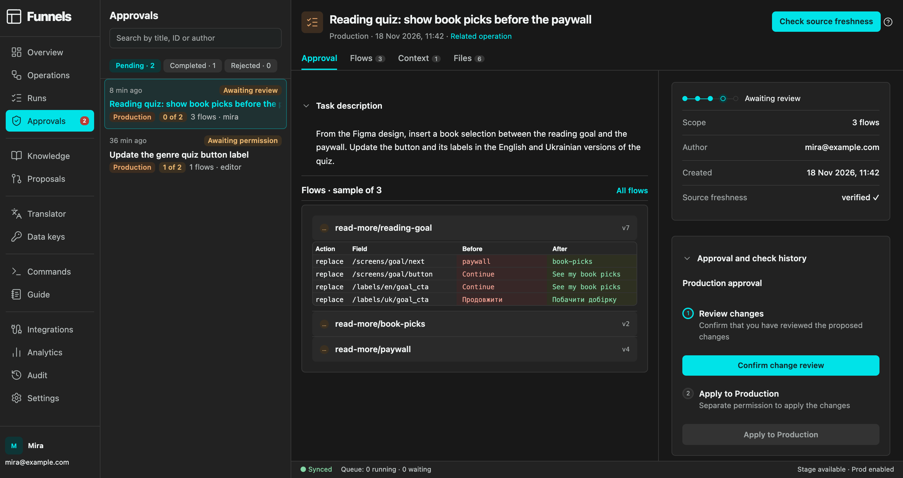
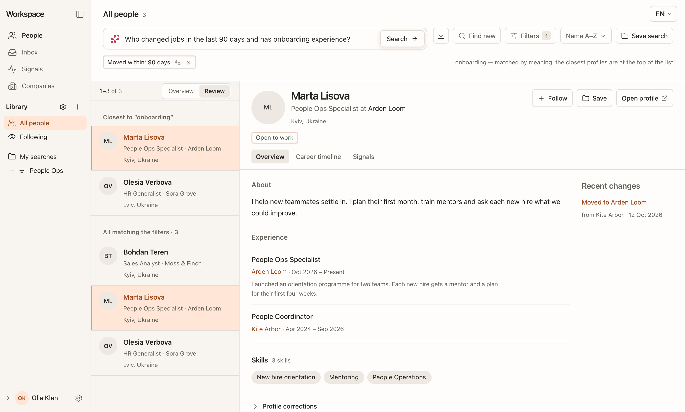
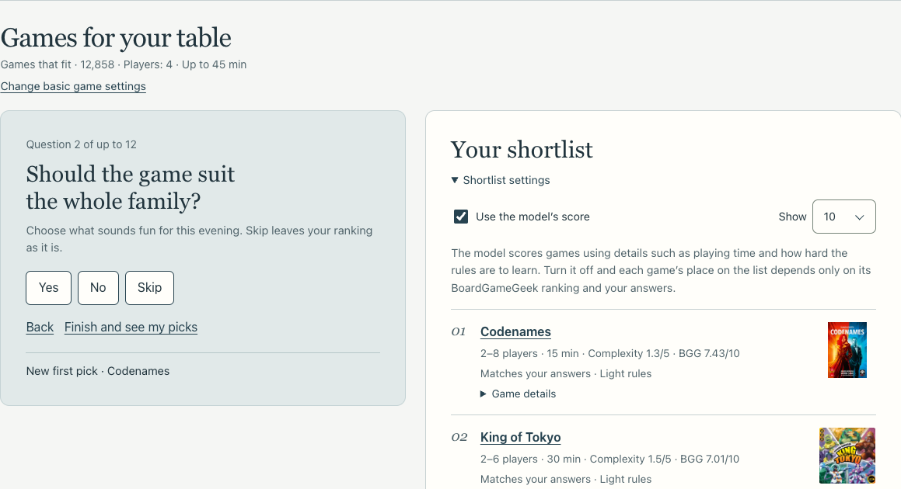

# Dariia Kukla · AI automation engineer

I build tools that help people with repetitive work. I recreated the OBRIO examples below with fictional data.

[Українською](README.uk.md) · [Interactive portfolio](https://perebendya.github.io/ai-automation-portfolio/?lang=en) · [LinkedIn](https://www.linkedin.com/in/dariia-kukla)

## From a Figma design to a subscription funnel

I built most of the platform for the growth team. In this reading quiz example, an editor checks the new route to a set of book picks and reviews the button label in two languages.

## Candidate search in plain language

I built the tool from profile import through search. In this fictional example, a recruiter asks for someone who recently changed jobs and has onboarding experience. The selected profile shows the evidence for both.

## Weekly moderation report in n8n

In this example, six fictional messages become a weekly moderation report. Mark a paint colour as a false positive and see how the totals change.

[Run the report](https://perebendya.github.io/ai-automation-portfolio/report.html?lang=en) · [n8n workflow](../weekly-report.json)

## Board Game Finder

I built this recommender for my System Analysis thesis to help a group pick a game for the evening. The website and the Python app use the same catalogue of 30,224 games and the same ranking rules.

**“There are four of us. We have 45 minutes and like simple rules.”** Group size and time give you a first shortlist. Answer the question about light rules and Azul comes first. Its card shows why it fits.

[Find a game](https://perebendya.github.io/ai-automation-portfolio/boardgames.html?lang=en) · [Python source](../board-game-finder/app.py) · [Model evaluation](../board-game-finder/README.md#training-and-verification)

## AI Rental Assistant

I built a Telegram bot that checks rental listings against a request in the renter’s own words. It collects listings from three sources and uses Gemini to inspect the photos.

**“I need a double bed.”** A sofa-only flat can drop out of the shortlist. If the bed is out of frame and the description says nothing, the bot drafts a question for the owner.

[Try the photo demo](https://perebendya.github.io/ai-automation-portfolio/rental.html?lang=en) · [Bot source and screenshots](https://github.com/perebendya/ai-rental-assistant) · [Python ranking example](../rental_demo.py)

The demo uses generated apartment photos to avoid republishing real listings. It uses prepared observations and includes two extra preferences you can try — kitchen colours and wall rugs.

## Other work

[Full list of projects](../README.md)

<strong>Independent and client projects</strong> · teaching, browser tools and apps

- **Math tutor** — used lesson history to generate worksheets and answer keys. Prototyped interactive homework and skill tracking.
- **Chrome extension** — grouped tabs by tool and tested the classification rules.
- **Job-search tracker** — built a local app that tracks the furthest interview stage separately from the outcome.
- **Grocery search** — built a ChatGPT plugin on an existing grocery MCP service to compare prices and promotions.
- **Client website** — delivered a commissioned two-page portfolio.

<strong>University projects</strong> · recommendations and data analysis

- **Board-game catalogue** — designed a PostgreSQL database, indexes and analytical queries. Modelled game localization as an ontology in separate coursework.
- **Marketing spend** — compared acquisition costs, revenue and return in Python and proposed a budget shift.
- **Graph analysis** — compared centrality measures and identified communities in a generated network.

