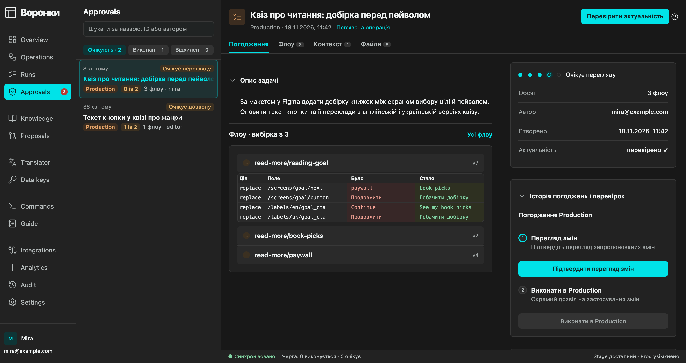
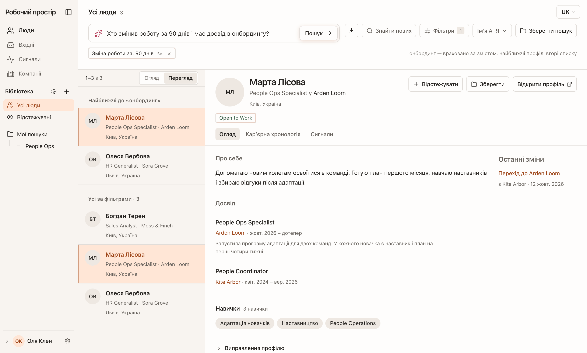
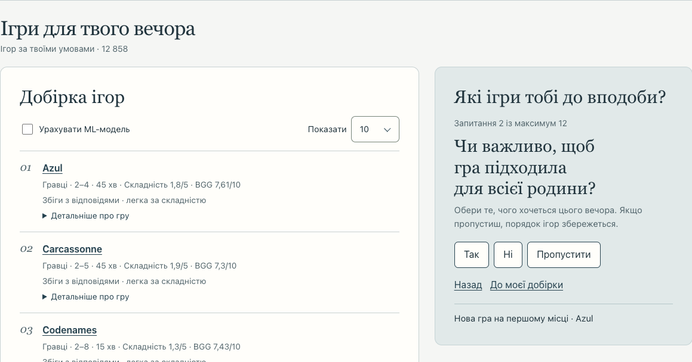

# Дарія Кукла · AI-автоматизації

Я будую інструменти, які допомагають людям швидше виконувати ручну роботу. Сценарії з досвіду в OBRIO я відтворила на вигаданих даних.

[English](README.md) · [Інтерактивне портфоліо](https://perebendya.github.io/ai-automation-portfolio/?lang=uk) · [LinkedIn](https://www.linkedin.com/in/dariia-kukla)

## Від макета Figma до воронки підписки

Я зібрала більшу частину платформи для команди зростання. У цьому прикладі редакторка квіза про читання перевіряє новий перехід до добірки книжок і підпис кнопки двома мовами.

## Пошук кандидатів звичайною мовою

Я зібрала інструмент від імпорту профілів до пошуку. У вигаданому сценарії рекрутерка шукає людину з досвідом онбордингу, яка нещодавно змінила роботу. У вибраному профілі видно обидва збіги.

## Щотижневий звіт про автомодерацію в n8n

У демо два тижні по 12 вигаданих повідомлень зі Slack. Розбери можливе хибне спрацювання й можливе порушення та подивись, як кожне рішення змінює звіт.

[Зібрати звіт](https://perebendya.github.io/ai-automation-portfolio/report.html?lang=uk) · [Воркфлоу n8n](../weekly-report.json)

## Підбір настільної гри

Для дипломної із системного аналізу я побудувала систему, яка підбирає настільні ігри для конкретної компанії. Сайт і застосунок на Python використовують каталог із 30 224 ігор і спільні правила ранжування.

**«Нас четверо, маємо 45 хвилин і хочемо прості правила».** Кількості гравців і часу вистачає для першої добірки. З увімкненою моделлю після відповіді про прості правила першою в добірці стає Codenames. У картці гри видно, чому вона підходить.

[Підібрати гру](https://perebendya.github.io/ai-automation-portfolio/boardgames.html?lang=uk) · [Код на Python](../board-game-finder/app.py) · [Як я перевіряла модель](../board-game-finder/README.md#training-and-verification)

## AI-рієлтор у Telegram

Я зробила бота, якому можна своїми словами описати бажану квартиру. Він збирає оголошення з трьох джерел, а через Gemini перевіряє, що видно на фото.

**«Хочу двоспальне ліжко».** Квартиру, де є лише диван, бот може відсіяти. Якщо ліжко не потрапило в кадр, а в описі про нього нічого немає, бот додає запитання в чернетку повідомлення власнику.

[Спробувати демо з фото](https://perebendya.github.io/ai-automation-portfolio/rental.html?lang=uk) · [Код і скриншоти бота](https://github.com/perebendya/ai-rental-assistant)

Фото квартир я згенерувала спеціально для демо, щоб не публікувати чужі оголошення. Браузерна версія працює з підготовленими описами фото. У ній можна спробувати ще два побажання — колір кухні й килим на стіні.

## Інші роботи

[Усі кейси](../CASES.md)

<strong>Власні та клієнтські проєкти</strong> · навчання, браузерні інструменти й застосунки

- **Помічник для уроків математики.** За журналом занять готує вправи й ключі. Окремо зібрала прототип інтерактивних домашок із прогресом за навичками.
- **Chrome-розширення.** Групує вкладки за інструментом. Правила класифікації покрила тестами.
- **Трекер вакансій.** Зібрала локальний застосунок, у якому окремо видно пройдений етап співбесід і результат відгуку.
- **Пошук продуктів.** Зробила плагін для ChatGPT поверх готового MCP-сервісу магазину, щоб порівнювати ціни й акції в чаті.
- **Клієнтський сайт.** Розробила на замовлення двосторінкове портфоліо.

<strong>Університетські проєкти</strong> · рекомендації та аналіз даних

- **Каталог ігор.** Спроєктувала базу PostgreSQL з індексами й аналітичними запитами. В окремій роботі змоделювала локалізацію ігор як онтологію.
- **Маркетингові витрати.** Порівняла в Python вартість залучення, дохід і окупність та запропонувала перерозподіл бюджету.
- **Аналіз графів.** Порівняла міри центральності вузлів і виділила спільноти у згенерованій мережі.

