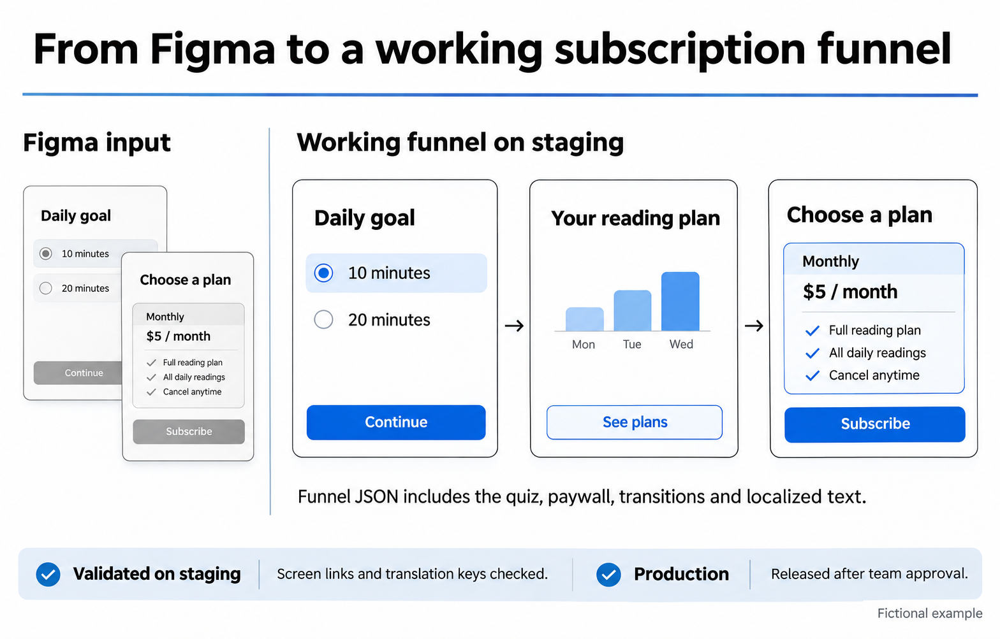

# Дарія Кукла · AI-автоматизації

Я будую інструменти для команд, у яких багато ручної роботи. В OBRIO допомагала growth-команді запускати воронки підписки, а рекрутерам — знаходити кандидатів за запитом звичайною мовою.

[English](README.md) · [Інтерактивне портфоліо](https://perebendya.github.io/ai-automation-portfolio/?lang=uk) · [LinkedIn](https://www.linkedin.com/in/dariia-kukla)

## З макета у Figma до воронки в продакшні

Я побудувала MCP-платформу, якою growth-команда користувалася щодня. Агент брав макет у Figma і збирав готову воронку з квізом, переходами та пейволом.

- **До релізу** автотести знаходили переходи на відсутні екрани й пропущені ключі перекладу.
- **Після тестів** команда проходила воронку, погоджувала її й запускала в продакшн. Подальші зміни теж вносили через платформу.

Подивитись шлях від макета до релізу на вигаданому прикладі

## Пошук кандидатів звичайною мовою

Я зібрала інструмент від імпорту й оновлення профілів до пошукового інтерфейсу. Рекрутерка могла попросити знайти людей, які нещодавно змінили роботу й мають досвід в онбордингу.

- **Спочатку — обов’язкові умови.** Пошук відбирав профілі, які підходили, наприклад, за датою зміни роботи.
- **Далі — досвід за змістом.** pgvector ранжував відібрані профілі, навіть якщо кандидати описали онбординг іншими словами. Видачу я перевіряла з рекрутерами на їхніх запитах.

## Щотижневий звіт про автомодерацію в n8n

Я автоматизувала розбір алертів зі Slack. Код прибирав дублі й рахував показники. Claude узагальнював коментарі модераторів і окремо перевіряв текстові та аудіоалерти без позначки на можливі хибні спрацювання.

**Що отримував менеджер.** Звіт із п’ятниці по четвер, розбитий на чотири частини. Ось скорочений приклад із першого тижня демо на вигаданих повідомленнях.

- **Текст.** Два алерти на можливі контактні дані. В одному модератор позначив хибне спрацювання — це був код кольору фарби. Один дубль прибрано.
- **Аудіо.** Модератор помітив повтор слів у транскрипті. У звіт потрапила одна технічна проблема.
- **Фото.** Написаний від руки код кольору нагадував номер телефону. Модератор відзначив цей випадок як неоднозначний.
- **Блокування експертів.** Користувач заблокував одного експерта. Причини в алерті не вказано.

[Запустити звіт і змінити реакцію модератора](https://perebendya.github.io/ai-automation-portfolio/report.html) · [Завантажити воркфлоу n8n](https://perebendya.github.io/ai-automation-portfolio/weekly-report.json)

## AI-рієлтор у Telegram

Я зробила бота, якому можна своїми словами описати бажану квартиру. Він збирає оголошення з трьох джерел, а через Gemini перевіряє, що видно на фото.

**«Хочу двоспальне ліжко».** Квартиру, де є лише диван, бот може відсіяти. Якщо ліжко не потрапило в кадр, а в описі про нього нічого немає, бот додає запитання в чернетку повідомлення власнику.

[Спробувати демо з фото](https://perebendya.github.io/ai-automation-portfolio/rental.html?lang=uk) · [Код і скриншоти бота](https://github.com/perebendya/ai-rental-assistant)

Фото квартир я згенерувала спеціально для демо, щоб не публікувати чужі оголошення. Браузерна версія працює з підготовленими описами фото. У ній можна спробувати ще два побажання — колір кухні й килим на стіні.

## Інші роботи

<strong>Growth</strong> · локалізація, релізи й експерименти

- **Локалізація.** Зібрала в Python і Colab інструменти для об’єднання вичитаних перекладів. Вони зберігали ціни й динамічні поля та дозволяли повторно використати погоджений текст.
- **Повтор після тайм-ауту.** Додала перевірку, чи збереглася зміна з першого разу, щоб повторний запит не створював дубль воронки.
- **Експерименти.** Збирала варіанти квізів, пейволів і апселів. До релізу перевіряла ціни, верстку справа наліво та події аналітики.
- **Передача роботи.** Написала інструкції для запуску воронок і описала, як працюють HR-автоматизації та Slack-застосунки.

<strong>Рекрутинг, підтримка та HR</strong> · інструменти й інтеграції

- **Командний застосунок для сорсингу.** Допрацювала перегляд оновлень, рольовий доступ і сповіщення про зміни у профілях.
- **Grafana та Slack.** Запропонувала дашборд для змін у профілях і налаштувала вибіркові сповіщення.
- **Jira та Zendesk.** Після закриття задачі розробниками автоматизація повторно відкривала пов’язане звернення й додавала результат для підтримки.
- **HR-процеси.** Відновила інтеграції для онбордингу, офбордингу й оцінювання колег після міграції.
- **Заявки на бенефіти.** Зібрала крок у n8n, де модель перевіряла заявку за правилами й пояснювала свою рекомендацію людині, яка її погоджувала.
- **Внутрішні Slack-застосунки.** Підтримувала сервіси для подяк, мерчу та привітань. Додала відзнаки за стаж і нагадування менеджерам.

<strong>Аналітика й дослідження</strong> · події, експерименти й попит

- **Продуктова аналітика.** Описала події для iOS, Android і вебу. Разом із QA підготувала сценарії перевірки.
- **Програма подяк.** Проаналізувала в Python, як менеджери нею користуються, і презентувала результати HR-команді.
- **Експеримент із підпискою** *(навчальна робота).* Порівняла конверсію й дохід у DuckDB та дослідила пік на розподілі тривалості сесій.
- **Прогноз навантаження** *(навчальна робота).* Оцінила, у які дні та години маркетплейсу потрібні додаткові експерти.
- **Дослідження.** Вивчала, як користувачі знаходять експертів і які зміни в кар’єрі кандидатів цікаві сорсерам.

<strong>Власні та клієнтські проєкти</strong> · навчання, браузерні інструменти й застосунки

- **Помічник для уроків математики.** За журналом занять готує вправи й ключі. Окремо зібрала прототип інтерактивних домашок із прогресом за навичками.
- **Chrome-розширення.** Групує вкладки за інструментом. Правила класифікації покрила тестами.
- **Трекер вакансій.** Зібрала локальний застосунок, у якому окремо видно пройдений етап співбесід і результат відгуку.
- **Пошук продуктів.** Зробила плагін для ChatGPT поверх готового MCP-сервісу магазину, щоб порівнювати ціни й акції в чаті.
- **Клієнтський сайт.** Розробила на замовлення двосторінкове портфоліо.

<strong>Університетські проєкти</strong> · рекомендації та аналіз даних

- **Рекомендації настільних ігор.** У дипломі із системного аналізу поєднала адаптивні запитання та навчання ранжуванню.
- **Каталог ігор.** Спроєктувала базу PostgreSQL з індексами й аналітичними запитами. В окремій роботі змоделювала локалізацію ігор як онтологію.
- **Маркетингові витрати.** Порівняла в Python вартість залучення, дохід і окупність та запропонувала перерозподіл бюджету.
- **Аналіз графів.** Порівняла міри центральності вузлів і виділила спільноти у згенерованій мережі.

