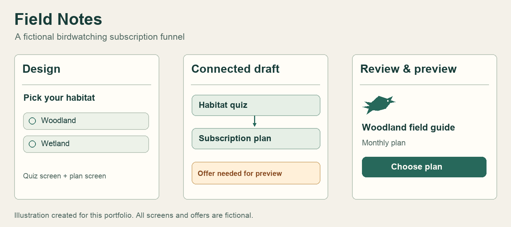

# Dariia Kukla · AI Automation & Internal Tools

At OBRIO (Genesis), I built a platform for creating subscription funnels, a search tool for recruiters, and a weekly reporting workflow. I work with AI agents, n8n, Python, and PostgreSQL. Based in Kyiv, open to hybrid work in Kyiv or remote roles.

## Building subscription funnels from Figma with AI agents

I built an MCP platform that the growth team used daily to build and update subscription funnels. A teammate could start with a Figma design, generate a draft with linked quiz screens and paywalls, then review it before launch. The agent flagged missing assets and offers for the team to supply.



In this portfolio example, the agent can connect the habitat quiz to the plan screen, but the design alone cannot tell it which subscription to sell. The draft flags the missing offer. Once a teammate selects a plan, they can preview the complete flow. I also built localization into the platform so the team could reuse reviewed translations across funnels.

[Українською · конструктор воронок](CASES.md#funnels)

## Recruiting search in plain language

Recruiters kept profiles in spreadsheets and tracked job changes by hand. I built the tool end to end, from importing and updating profiles to a search interface that combined exact filters with semantic matching in PostgreSQL.

**Sample search using fictional data**

> Find product managers who changed companies in the last 90 days and have worked on onboarding.

The time window is a filter. Onboarding experience is a match by meaning. A fictional result might read **Profile A · changed companies 42 days ago · redesigned the first-run experience for new subscribers**. A profile that moved 120 days ago falls outside the window, however relevant its experience.

I used sample queries from recruiters to check whether the results matched their expectations. After staging tests, I handed the tool and documentation to the team.

[Українською · пошук для рекрутерів](CASES.md#search)

## Weekly reporting with n8n

A manager used to read moderation alerts and replies across Slack channels to write a weekly report. I built an n8n workflow that gathered the alerts, removed duplicates, and counted them in JavaScript. Claude drafted the summary for review.

During the pilot, the manager told me they still checked every alert that had no response. I added a separate review of those alerts so the manager could see which ones might be false positives.

> **Example report · fictional data**
>
> 12 unique alerts this week. Moderators responded to 9. Of the 3 with no response, 1 was flagged as a possible false positive for review.

If the model was unavailable, the workflow still delivered the counts and the moderators’ comments. The manager could finish the report with the evidence already collected.

[Українською · щотижневий звіт](CASES.md#report)

## Personal project · AI Rental Assistant

My Telegram bot ranks apartment listings against my preferences. This small, runnable example shows how the text-ranking step handles a match, a contradiction, and missing information. It uses three synthetic listings and runs offline with Python 3.

```sh
python3 rental_demo.py
```

The first listing scores **+6** for a bed, permission to keep pets, and a gas stove. The listing that mentions only a gas stove scores **+1**. Each result includes a breakdown by preference.

[View the ranking code](rental_demo.py) · [Connect on LinkedIn](https://www.linkedin.com/in/dariia-kukla)
